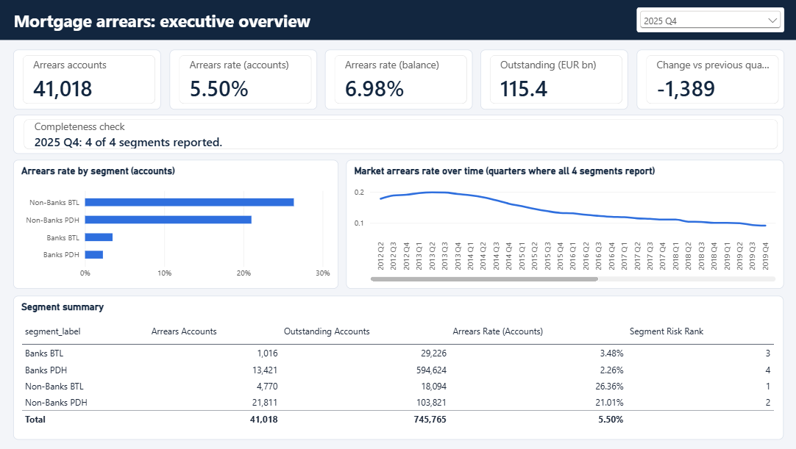
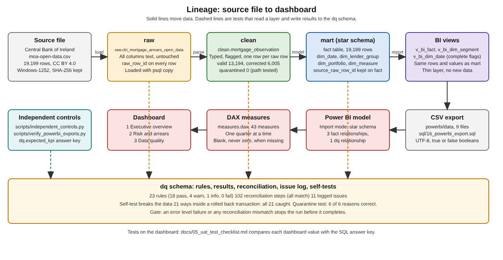
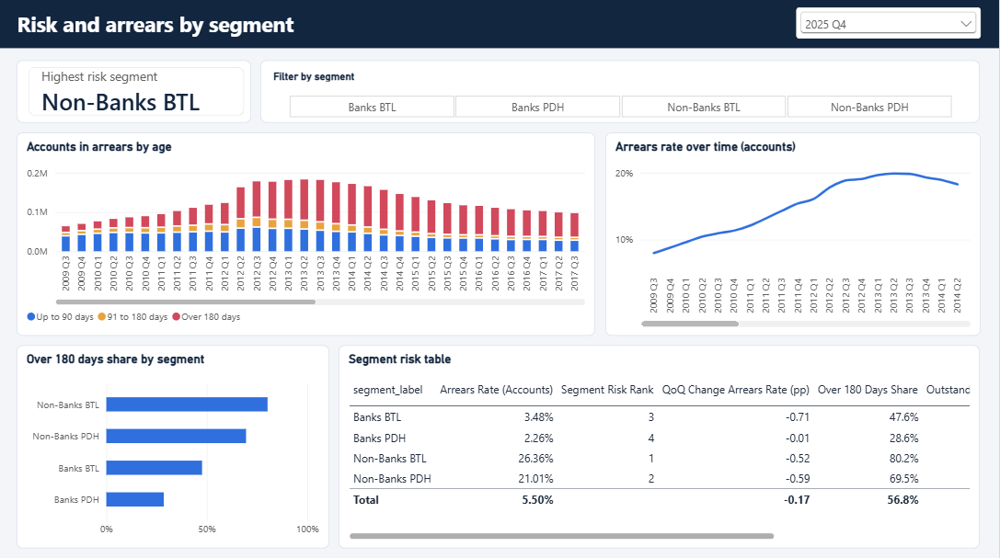
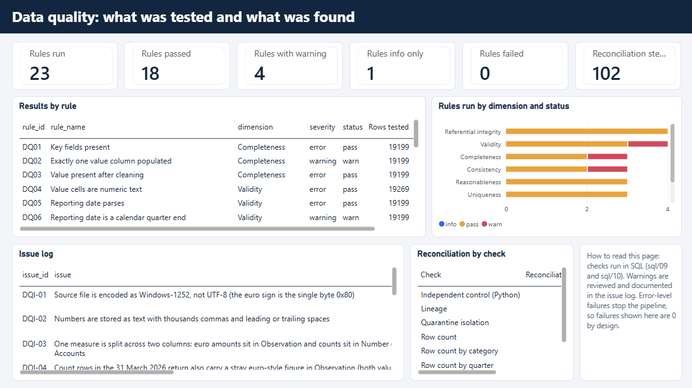

# Mortgage Portfolio MI and Data Quality Dashboard

An end to end management information project built on real public data: raw regulatory data goes through SQL cleaning and data quality controls into a star schema, and ends in a three page Power BI dashboard with documented lineage and a test checklist.

The point of the project is trust. Every number on the dashboard can be traced back to the source file, and every number is checked against an independent SQL answer key.

## Business problem

Credit risk and finance teams need mortgage arrears figures they can rely on. Regulatory data arrives with quirks: numbers stored as text, shifting dates, category schemes that change over time, and segments that stop reporting. A dashboard built straight on top of that can show wrong numbers with full confidence. This project builds the controlled path from raw file to dashboard, and shows the controls on the dashboard itself.

## The data

Central Bank of Ireland, Residential Mortgage Arrears and Repossession Statistics (open data, CC BY 4.0). Source details, download date and SHA-256 hash are in data/SOURCE.md.

- Aggregate quarterly data by lender group (Banks, Non-Banks) and portfolio (PDH is principal dwelling home, BTL is buy to let). It is not loan-level data.
- It is not PTSB data, and nothing here says anything about any one lender.
- 19,199 rows covering 2009 Q3 to 2026 Q1. Euro values are in thousands of euro as published.

## Method

Raw (all text) to clean (typed and flagged) to mart (star schema) to BI views to nine CSV files to a Power BI import model. The full picture, with one number traced end to end, is in docs/07_lineage.md.

Design choices worth knowing:

- Raw is never fixed. Cleaning is visible SQL with one clean row per raw row, each carrying a status: valid 13,194, corrected 6,005, quarantined 0.
- The fact table grain is quarter, lender group, portfolio and measure (19,199 rows). It keeps the source row id so any value traces back to the file.
- Values are positions at a quarter end, so the DAX never adds across quarters. One Report Date drives every measure: the single quarter selected, otherwise the latest complete quarter.
- Missing is shown as blank, never zero. Quarter on quarter change is blank when the two quarters do not cover the same segments.

## Findings (2025 Q4, all four segments reporting)

- 41,018 accounts in arrears out of 745,765 outstanding, an arrears rate of 5.50% by accounts and 6.98% by balance. Accounts in arrears fell by 1,389 on the previous quarter, and the rate fell 0.17 percentage points.
- Outstanding balance is about 115.4 billion euro and the balance in arrears about 8.0 billion euro.
- By segment, the arrears rate by accounts is 2.26% for Banks PDH, 3.48% for Banks BTL, 21.01% for Non-Banks PDH and 26.36% for Non-Banks BTL. Non-Banks BTL is ranked highest risk.
- Arrears are long running: 56.8% of accounts in arrears are over 180 days, from 28.6% for Banks PDH up to 80.2% for Non-Banks BTL.
- The market arrears rate peaked at 19.89% in 2013 Q2 and is 5.50% in 2025 Q4.

How to read these: the higher non-bank rates do not show that non-banks are riskier lenders, because the portfolios differ in mix and history, which this data cannot show. The market series is also not like for like over time, because the bank and non-bank mix changes between quarters.

## Data quality

- 23 rules run: 18 pass, 4 warn, 1 info, 0 fail. An error-level failure or any reconciliation mismatch stops the pipeline, so 0 failures is by design.
- 102 reconciliation steps from raw to mart, all matching (row counts, control totals, lineage, quarantine path and independent Python controls).
- 11 issues logged with severity and resolution in docs/dq_issue_tracker.csv, for example: the source file is Windows-1252 not UTF-8, numbers are text with thousands commas, reporting dates are not calendar quarter ends, arrears bucket schemes change over time (3, 5 then 7 buckets), and 2026 Q1 has no Banks PDH arrears or outstanding figures.
- Self-test: 21 deliberate corruptions are injected inside a rolled back transaction and all 21 are caught. Quarantine path test: 6 of 6 reasons handled.
- Independent Python controls recompute totals from the source file without SQL.

## Testing

- docs/05_uat_test_checklist.md lists each dashboard value, the SQL expected value and a place to record the outcome.
- scripts/verify_powerbi_exports.py recomputes the latest quarter from the CSV files Power BI reads and compares it with the SQL answer key (34 comparisons).
- Bugs found through testing and fixed are written up in docs/04_power_bi_model_and_dax.md, for example a false change of minus 13 thousand accounts when one segment was missing from a quarter.

## Limitations and honest caveats

- Aggregate data only, so there is no loan-level analysis, and no PTSB data.
- Two reporting dates, 01/09/2025 and 01/12/2025, are malformed. They were mapped to 30 Sep 2025 and 31 Dec 2025 by inference (issue DQI-06). The headline 2025 Q4 values come from rows dated this way.
- 2026 Q1 has no Banks PDH arrears or outstanding figures, so it is not treated as a complete quarter. The dashboard defaults to the latest complete quarter, 2025 Q4.
- Legal status counts do not always add up to total arrears in the source, so they are not used for headline figures.
- The Issue Rows Affected measure must not be added up, because one row can break several rules (the sum is 38,339 against 19,199 rows).

## Reproduce

Requirements: PostgreSQL 14 or later with the psql client, Python 3, and Power BI Desktop for the dashboard.

1. Create an empty UTF-8 database: `createdb -U postgres -E UTF8 -T template0 mortgage_mi`
2. From the repository root run the whole pipeline: `psql -X -v ON_ERROR_STOP=1 -U postgres -d mortgage_mi -f sql/run_all.sql`. A successful run ends with a banner that starts PIPELINE COMPLETE, and any failed check stops the run with an ERROR. It also rewrites the nine CSV files in powerbi/data and docs/dq_issue_tracker.csv.
3. Optional controls: `python scripts/independent_controls.py` and `python scripts/verify_powerbi_exports.py` (the second must print PASSED).
4. Open powerbi/mortgage_mi.pbix in Power BI Desktop. If it cannot find the data, open Home, Transform data, Data source settings, and point each CSV source at your copy of powerbi/data. To rebuild the model from scratch, follow docs/04_power_bi_model_and_dax.md and paste in the measures from powerbi/measures.dax.

The scripts are safe to run again. Use sql/run_day1.sql, sql/run_day2.sql or sql/run_day3.sql to run one stage only.

## Repository layout

- data: the source file (never edited) and the source note
- sql: numbered scripts, run in order by run_all.sql
- scripts: independent control scripts (standard library Python)
- powerbi: mortgage_mi.pbix, the same report as a text project in pbip, measures.dax, the theme, and the data CSV files
- docs: data profile, star schema design, cleaning and data quality, Power BI model and DAX, UAT checklist, data dictionary, lineage, layout guide, issue tracker, images

## Documentation

- docs/01_data_profile.md: what is in the source file
- docs/02_star_schema_design.md: tables, grain and keys
- docs/03_cleaning_and_data_quality.md: cleaning rules, the 23 checks, reconciliation
- docs/04_power_bi_model_and_dax.md: model, measures and interview style explanations
- docs/05_uat_test_checklist.md: dashboard versus SQL answer key
- docs/06_data_dictionary.md: every table, column and measure
- docs/07_lineage.md: source to dashboard, with one traced number
- docs/08_dashboard_layout_guide.md: how the pages were laid out

## PostgreSQL to SQL Server notes

`\copy` becomes BULK INSERT or the import wizard, `generate_series` for dates becomes a recursive CTE or a calendar table, `CREATE TABLE AS` becomes `SELECT INTO`, and PL/pgSQL functions become T-SQL stored procedures.

## Tech stack

PostgreSQL (SQL and PL/pgSQL), Python 3 (standard library), Power BI (Power Query, DAX), Git.

## Attribution

Contains data from the Central Bank of Ireland, used under CC BY 4.0. This project is not endorsed by the Central Bank of Ireland.
