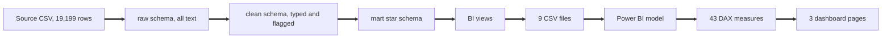

# Lineage: from the source file to the dashboard

This page shows where every number on the dashboard comes from, layer by layer, and traces one number all the way back to the text in the source file.

The same flow as text:

## What each layer does

- Source: `data/raw/moa-open-data.csv`, never edited. SHA-256 recorded in data/SOURCE.md so anyone can confirm they have the same file.
- raw: every column loaded as text, plus `raw_row_id` on every row. Nothing is fixed here, so raw can always be compared with the file.
- clean: one row per raw row. Numbers with thousands separators become numbers, dates become quarter end dates, and every change sets a flag and a `dq_status` of valid, corrected or quarantined. Counts on the real data: valid 13,194, corrected 6,005, quarantined 0.
- mart: the star schema. The fact table has one row per quarter, lender group, portfolio and measure (19,199 rows) and keeps `source_raw_row_id`, which points back to raw.
- BI views: thin views that add keys and flags for Power BI (`v_bi_fact`, `v_bi_dim_segment`, `v_bi_dim_date`). No values change.
- CSV export and Power BI model: nine files read in Import mode. The fact table joins to date, segment and measure by single direction relationships.
- DAX measures and dashboard: see docs/04_power_bi_model_and_dax.md.
- Controls: the dq schema reads each layer and writes rule results, reconciliation steps and an issue log. An independent Python script recomputes control totals from the file, and `dq.expected_kpi` holds the SQL answer key that the dashboard is tested against (docs/05_uat_test_checklist.md).

## One number traced end to end

The dashboard shows Banks PDH, 2025 Q4, accounts in arrears as 13,421. This is how that value got there.

1. Source and raw. Raw row 18458 has reporting_date `01/12/2025`, entity_group `Banks`, format_code `PDH`, row_label `Arrears: Total mortgage accounts in arrears`, and number_of_accounts `13,421` (text, with the comma).
2. clean. The same raw_row_id has quarter_end_date 2025-12-31 and value 13421. The date `01/12/2025` is not a quarter end, so the rule repaired it to the calendar quarter end. That sets `date_remapped` to true, `number_text_cleaned` to true, `date_rule` to `repaired_malformed_date`, and dq_status to `corrected` with the reason "reporting date remapped to calendar quarter end".
3. mart. The fact row has date_key 20251231, lender_group_key 1, portfolio_key 1, measure_key 1, value 13421 and source_raw_row_id 18458.
4. Dashboard. The measure Arrears Accounts filters the fact table to measure_code ARREARS_ACCOUNTS and the report date 31 Dec 2025, and returns 13,421 for the Banks PDH segment.

Honest caveat on step 2: mapping `01/12/2025` to 31 December 2025 is an inference. It uses the evidence stored in `clean.reporting_date_map_repairs` and is logged as issue DQI-06 in docs/dq_issue_tracker.csv. The headline 2025 Q4 values all come from rows dated this way, so a reader should know the result depends on that repair.
